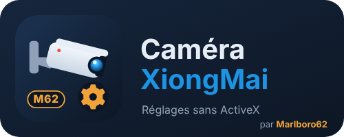

  ☕ <strong>Si cette intégration vous est utile, vous pouvez soutenir le projet :</strong>

  &nbsp;&nbsp;

# Caméra XiongMai pour Home Assistant (intégration)

**Intégration Home Assistant pour les caméras IP XiongMai / XMEye / NetSurveillance**, reliée directement à la caméra par son propre protocole (DVRIP, port 34567) : **sans cloud, sans MQTT, sans ActiveX**.

Elle crée un appareil par caméra :

| Entité | Rôle |
| --- | --- |
| **Mouvement** | Détection de mouvement de la caméra, en direct (alarmes envoyées par la caméra) |
| **Détection de mouvement** | Active ou coupe la détection |
| **Sensibilité de la détection** | 1 (faible) à 6 (forte) |
| **Mode jour / nuit** | Automatique, toujours en couleur, toujours en noir et blanc |
| **Image miroir**, **Image retournée** | Sens de l'image |
| **Cloud XMEye** | Connexion au cloud du fabricant (à couper si la caméra n'a pas Internet) |
| **Redémarrer**, **Mettre à l'heure de Home Assistant** | Boutons |
| **Connexion**, **Temps de fonctionnement** | Diagnostic |

## Et l'application ?

Pour **tous** les réglages du firmware (image, exposition, zones de détection dessinées sur l'image, plages horaires, réseau, heure d'été, sauvegardes…), installez aussi l'application **[Caméra XiongMai](https://github.com/Marlboro62/xiongmai-camera)**. Les deux se complètent :

- **l'intégration** : les entités, pour les tableaux de bord et les automatisations ;
- **l'application** : la page de réglages complète, dans la barre latérale.

Si vous utilisez l'intégration, coupez les entités MQTT de l'application (**Entités (MQTT) › Entités Home Assistant**) pour ne pas avoir deux appareils pour la même caméra.

Pour la **vidéo**, utilisez l'intégration **ONVIF** de Home Assistant (port 8899) ou une caméra générique avec l'adresse RTSP (page **Flux et accès** de l'application).

## Installation

1. **Marketplace** (ou HACS avant la 2026.11) : bouton ci-dessus, ou **Marketplace › ⋮ › Dépôts personnalisés**, `https://github.com/Marlboro62/xiongmai-camera-integration`, catégorie **Intégration**.
2. Installez **Caméra XiongMai**, puis redémarrez Home Assistant.
3. **Paramètres › Appareils et services › Ajouter une intégration › Caméra XiongMai** : nom, adresse IP, port (34567), utilisateur et mot de passe de la caméra.

Pour changer l'adresse ou le mot de passe plus tard : **⋮ › Reconfigurer** sur l'intégration.

## Bon à savoir

- Le capteur **Mouvement** utilise les alarmes que la caméra envoie elle-même : la détection de mouvement doit être **activée**, avec l'action **« Envoi au Centre d'alarme / application »** cochée (réglage *MessageEnable*, page Détection de l'application).
- Testée avec une caméra au firmware V4.02 (2017). Les firmwares XiongMai varient : un réglage absent de votre modèle ne crée simplement pas d'entité.
- Les diagnostics masquent le mot de passe, l'adresse et le numéro de série.

## Signaler un problème

Ouvrez une [issue GitHub](https://github.com/Marlboro62/xiongmai-camera-integration/issues) avec le modèle de la caméra, la version du firmware et les diagnostics de l'intégration. **Masquez le numéro de série et vos adresses.**

## Licence

MIT. Projet indépendant, sans lien avec Hangzhou Xiongmai Technology. XiongMai, XMEye et NetSurveillance sont des marques de leurs propriétaires.
